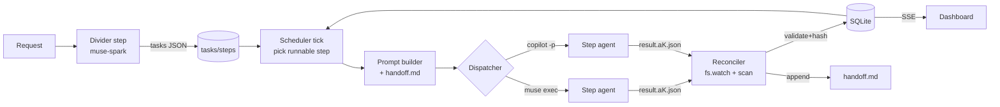

# OrchestratorLoop Control Plane — Concrete Plan

Status: Implemented locally (backend + dashboard), tests green, not deployed | Created: 2026-10-31

## Resolved decisions (2026-10-31)
- Dispatcher: user picks Muse CLI or GitHub Copilot CLI per request (default `muse`; unavailable dispatchers are shown disabled with the reason).
- Pause/Resume: kept as an optional, server-side control (`POST /api/control/loop/pause|resume`). The loop is otherwise always Auto.
- Parallelism: one step at a time (single engine slot).
- Task types: one seeded `generic` type (analyst → coder → tester → summarizer style). The divider may compose others; screenshot types are not copied.
- Full refactor allowed: the legacy assistant view, the auto toggle and the old task/pipeline UI were removed.

## Implementation map
- Backend: `src/loop/{store,engine,dispatchers,task-types,workspace}.js`, `src/routes/loop.js`, engine started/stopped in `src/headless-dashboard.js`.
- Dashboard: `views/loop.js` (board, ring, drawer, 5 detail tabs, mermaid pipeline), `views/md.js` (marked + dompurify, lazy mermaid + panzoom), `css/loop.css`; `board.js` = Tasks / Automation runs tabs; `main.js` wires the SSE `/stream` (debounced) and loop actions.
- Verification: `npm test` 159/159, `npm run validate` OK, build OK, live GET smoke test on :3002 (status, dispatchers, task-types, agents, requests, /dashboard).
Reference: `/home/aniketsatpute/Downloads/images/*.jpeg` (15 screenshots)
Supersedes UI scope of `docs/dashboard-upgrade-plan.md`. Backend hardening from that plan (jobs, envelope, provider gate, SSE, access) is reused, not redone.

## 0. Scope

In:
- Board (task list + split detail), Overview / Steps / Activity / Diagrams / Sessions tabs
- Request intake (Request / Direct task), auto-divided into tasks → steps
- Automations (template shelf, flow rows, trigger + ordered step editor)
- Brain messages, TODOs, Configuration, Requests, Outbox, Activity, Retro
- Sidebar status counts, topbar (filter `/`, Commands `⌘K`, Pause/Resume, refresh, Live)
- Orchestrator: dispatcher (Muse CLI / Copilot CLI) → step agent writes JSON → reconcile → DB → next step, `handoff.md` between agents

Out (explicit):
- Assistant nav item, ADO items nav item
- PR link / Open PR / PR badge / "Request changes" (PR-bound) / Sweep PRs / Sweep PR comments
- Auto toggle and plan-confirmation gates — **the loop is always Auto**. Divider output is enqueued immediately; no "confirm" step. Pause/Resume stays as a global emergency stop only.
- Copied task types from the screenshots (Coding, PM spec, Live-site…). Task types are user-defined or composed by the divider at runtime.

## 1. Domain model

```
Request ──1:N──► Task ──1:N──► Step ──1:N──► Attempt (one dispatcher session)
                   │              │
                   │              └── result JSON (written by agent) ──► reconcile ──► DB
                   └── workspace data/tasks/task-<id>/handoff.md  (agent ⇄ agent channel)
```

- **Request**: raw goal from dashboard / Discord / automation. Divider step turns it into 1..N tasks.
- **Task**: a unit with an end goal, an ordered step pipeline, optional `depends_on` other tasks of the same request.
- **Step**: one role (agent id from `config/agents.json`) + step goal. Steps in a task run strictly sequentially.
- **Attempt**: one dispatcher session for a step. Retries / re-queue create a new attempt; old attempts are immutable.
- **Task type** (optional template): `{id, name, description, steps:[{role, goal}]}` in `config/task-types.json`. Divider may pick one, or compose an ad-hoc pipeline from available agents. Ships empty except one generic example.

### 1.1 Status machines

Task: `queued → running → (blocked | failed | done)`; `blocked → running` (unblock/requeue); `* → cancelled`.
Step: `pending → dispatched → running → (done | failed | blocked)`; `failed → dispatched` (auto-retry ≤ `maxAttempts`, default 3); requeue resets step N and everything downstream to `pending`.
Request: `dividing → active → (done | partial | failed)` derived from its tasks.

### 1.2 SQLite schema (additive migration on existing `data/tab-automation.db`)

Reuse and extend existing `requests`, `tasks`, `task_steps`, `session_attempts`. New: `task_events`, `task_artifacts`.

```sql
-- requests (exists) + columns
ALTER TABLE requests ADD COLUMN source TEXT NOT NULL DEFAULT 'dashboard';   -- dashboard|discord|automation|brain
ALTER TABLE requests ADD COLUMN divider_output TEXT NOT NULL DEFAULT '';    -- raw divider JSON
ALTER TABLE requests ADD COLUMN updated_at TEXT;

-- tasks (exists) + columns
ALTER TABLE tasks ADD COLUMN request_id TEXT;            -- FK requests.id
ALTER TABLE tasks ADD COLUMN seq INTEGER;                -- human #N
ALTER TABLE tasks ADD COLUMN depends_on TEXT NOT NULL DEFAULT '[]';
ALTER TABLE tasks ADD COLUMN current_step INTEGER NOT NULL DEFAULT 0;
ALTER TABLE tasks ADD COLUMN steps_total INTEGER NOT NULL DEFAULT 0;
ALTER TABLE tasks ADD COLUMN steps_done INTEGER NOT NULL DEFAULT 0;
ALTER TABLE tasks ADD COLUMN workspace TEXT NOT NULL DEFAULT '';   -- data/tasks/task-<id>
ALTER TABLE tasks ADD COLUMN dispatcher TEXT NOT NULL DEFAULT 'muse'; -- muse|copilot
ALTER TABLE tasks ADD COLUMN requeue_count INTEGER NOT NULL DEFAULT 0;

-- task_steps (exists) + columns
ALTER TABLE task_steps ADD COLUMN role TEXT NOT NULL DEFAULT '';     -- agent id
ALTER TABLE task_steps ADD COLUMN goal TEXT NOT NULL DEFAULT '';
ALTER TABLE task_steps ADD COLUMN summary TEXT NOT NULL DEFAULT '';
ALTER TABLE task_steps ADD COLUMN attempt INTEGER NOT NULL DEFAULT 0;
ALTER TABLE task_steps ADD COLUMN guidance TEXT NOT NULL DEFAULT '';  -- requeue guidance
ALTER TABLE task_steps ADD COLUMN started_at TEXT;
ALTER TABLE task_steps ADD COLUMN finished_at TEXT;

-- session_attempts (exists) + columns
ALTER TABLE session_attempts ADD COLUMN task_id TEXT;
ALTER TABLE session_attempts ADD COLUMN dispatcher TEXT NOT NULL DEFAULT 'muse';
ALTER TABLE session_attempts ADD COLUMN context TEXT NOT NULL DEFAULT 'fresh'; -- fresh|resumed
ALTER TABLE session_attempts ADD COLUMN transcript_path TEXT NOT NULL DEFAULT '';
ALTER TABLE session_attempts ADD COLUMN exit_code INTEGER;
ALTER TABLE session_attempts ADD COLUMN finished_at TEXT;

CREATE TABLE IF NOT EXISTS task_events (           -- drives Activity tab + global Activity view
  id INTEGER PRIMARY KEY AUTOINCREMENT,
  task_id TEXT NOT NULL, step_pos INTEGER, attempt INTEGER,
  kind TEXT NOT NULL,      -- created|dispatched|completed|failed|blocked|requeued|reconciled|handoff|note
  message TEXT NOT NULL DEFAULT '', created_at TEXT NOT NULL);
CREATE INDEX IF NOT EXISTS idx_task_events_task ON task_events(task_id, id);

CREATE TABLE IF NOT EXISTS task_artifacts (        -- diagrams, files, links produced by steps
  id TEXT PRIMARY KEY, task_id TEXT NOT NULL, step_pos INTEGER, attempt INTEGER,
  kind TEXT NOT NULL,      -- diagram|file|markdown|link
  title TEXT NOT NULL DEFAULT '', body TEXT NOT NULL DEFAULT '', path TEXT NOT NULL DEFAULT '',
  created_at TEXT NOT NULL);
```

Legacy `runs`/`run_steps` stay for automations ("Automation runs" tab). No destructive changes.

### 1.3 Task workspace layout (file protocol)

```
data/tasks/task-<id>/
  task.json                       # snapshot: title, end_goal, steps[], written by orchestrator
  handoff.md                      # append-only agent ⇄ agent log (single writer: reconciler)
  attachments/                    # request attachments copied in
  steps/<NN>-<role>/
    prompt.a<k>.md                # full prompt sent (variant k = attempt)
    context.a<k>.md               # context bundle sent
    result.a<k>.json              # WRITTEN BY THE AGENT
    transcript.a<k>.jsonl         # dispatcher stdout (muse --json / copilot log)
```

### 1.4 Step result JSON contract (`schemas/step-result.schema.json`)

```json
{
  "v": 1,
  "task_id": "string", "step": 2, "attempt": 1, "role": "coder",
  "status": "done | failed | blocked",
  "summary": "one line",
  "output": "markdown — main result",
  "handoff": "markdown — what the next agent must know (decisions, files touched, open issues)",
  "artifacts": [{ "kind": "diagram|file|link|markdown", "title": "", "body": "", "path": "" }],
  "blocked_reason": "",
  "spawn_tasks": [{ "title": "", "end_goal": "", "steps": [{ "role": "", "goal": "" }] }],
  "metrics": { "tokens": 0, "tool_calls": 0 }
}
```

Rules: agent writes the file at the exact path given in the prompt (atomic: write `.tmp` then rename). Orchestrator owns ids/hash; it validates, hashes (sha256), and records the hash in `session_attempts.result_hash` (unique → exactly-once reconcile). If the file is missing at exit, fallback to the last JSON object on stdout (existing tolerant parser). Unknown status ⇒ `failed` (fail closed).

### 1.5 `handoff.md` format

```md
# Handoff — Task #12: <title>
End goal: <end goal>

## Step 1 · planner · attempt 1 · done · 2026-10-31T10:02Z
<handoff markdown from result.json>

## Step 2 · coder · attempt 2 · done · 2026-10-31T10:20Z
Re-queued with guidance: "<guidance>"
<handoff markdown>
```

Every step prompt includes: role system prompt, task end goal, this step's goal, the **full `handoff.md` path** (agent reads it), prior step outputs summary, guidance, and the result-file path + schema.

## 2. Orchestrator



Modules (new under `src/loop/`):

| File | Responsibility |
|---|---|
| `src/loop/divider.js` | Build divider prompt (request + attachments + task-type catalog + agent catalog) → dispatch → parse `{tasks:[…]}` → create tasks/steps. Falls back to heuristic `divideGoal` if divider fails. |
| `src/loop/prompt.js` | Build step prompt + context bundle; write `prompt.aK.md`, `context.aK.md`. |
| `src/loop/dispatchers/index.js` | `getDispatcher(name)` → adapter with `dispatch({cwd, workspace, promptFile, resultPath, sessionId, model, timeoutMs, signal}) → {exitCode, stdoutPath}`. |
| `src/loop/dispatchers/muse.js` | Wrap existing `runner.js` spawn: `muse exec --provider meta --model muse-spark-1.3 --workspace <repo> --prompt-file … --session-id … --json --output-schema schemas/step-result.schema.json --approval-mode never …` |
| `src/loop/dispatchers/copilot.js` | `copilot -p "<prompt-file contents or @file>" --allow-all-tools --add-dir <workspace> [--model …]` (flags verified in spike S1). |
| `src/loop/reconcile.js` | Watch `data/tasks/*/steps/*/result.*.json` (fs.watch + 10 s scan for robustness); validate; claim hash; write step/task/attempt/events/artifacts; append handoff; spawn follow-up tasks; emit SSE. |
| `src/loop/engine.js` | State machine: pick next runnable step (respect `depends_on`, global concurrency `LOOP_MAX_PARALLEL` default 2, Pause flag); retries with `redispatchPrompt`; requeue-from-step; derive task/request status. Runs inside existing `services/worker.js` tick. |
| `schemas/step-result.schema.json`, `schemas/divider.schema.json` | Contracts (ajv-validated). |

Existing pieces reused: `services/jobs.js` (durable queue, idempotency), `services/runner.js` (secret-stripped env, process-group kill, budgets), `services/provider-gate.js`, `services/events.js` (SSE), `orchestrator.js` (`reconcileSessionJson`, `requeueFromStep`, `redispatchPrompt`).

## 3. API (Hono, `src/routes/loop.js`)

| Method | Path | Purpose |
|---|---|---|
| POST | `/api/loop/requests` | `{text, mode:"request"\|"direct", repo, taskType?, attachments[]}` → 202 `{requestId}`; divider runs async, auto-enqueues |
| GET | `/api/loop/requests` | list with derived status |
| GET | `/api/loop/tasks?status=&q=&group=&sort=` | board list (seq, title, repo, type, steps_done/total, status, updated) |
| GET | `/api/loop/tasks/:id` | task + steps + latest attempts |
| GET | `/api/loop/tasks/:id/events?after=` | Activity |
| GET | `/api/loop/tasks/:id/artifacts` | Diagrams + files |
| GET | `/api/loop/tasks/:id/sessions` | attempts list (stage · date · Fresh/Resumed, runner, model, workspace, transcript) |
| GET | `/api/loop/tasks/:id/sessions/:attemptId/transcript?tail=` | recent transcript messages |
| GET | `/api/loop/tasks/:id/handoff` | raw handoff.md |
| GET | `/api/loop/tasks/:id/steps/:pos/attempts/:k/{prompt,context,result}` | Steps tab drill-down |
| POST | `/api/loop/tasks/:id/requeue` | `{fromStep, guidance}` |
| POST | `/api/loop/tasks/:id/action` | `mark_done \| block \| unblock \| cancel \| delete \| append_task` |
| GET | `/api/loop/status-counts` | sidebar counts |
| POST | `/api/loop/pause`, `/api/loop/resume` | global stop |
| GET | `/api/loop/task-types` / POST | task-type registry CRUD |
| SSE | `/api/feed/stream` | add `loop` event: `{type, taskId, stepPos, status}` |

All mutations go through existing `mutationGuard`.

## 4. Frontend

Stack stays: Vite 8 + modular vanilla JS + existing region renderer + Lucide + focus-trap. No framework rewrite (Termux build, current code investment, region-hash render already works).

### 4.1 Libraries

| Need (screenshot) | Library | Why | Cost |
|---|---|---|---|
| Diagrams tab + fullscreen "Edit diagram", flow boxes with labelled edges | **mermaid** 12 | Agents emit Mermaid text in `artifacts[kind=diagram]`; layout is free. Lazy `import()` only on Diagrams tab. | heavy, lazy chunk |
| "Scroll to pan · Ctrl+scroll to zoom" | **@panzoom/panzoom** 4.6 | Tiny, no deps, wheel+pinch | ~10 KB |
| End goal / step output / handoff rendered rich | **marked** 18 + **dompurify** 3 | Agent markdown must be sanitized (XSS — agent output is untrusted) | ~60 KB |
| "Every day at 11:00 AM", next run | **cronstrue** (client) + **croner** (server, tz/DST-correct next run) | Replace hand-rolled `nextCronRun` | small |
| Result/divider JSON validation | **ajv** 8 (server) | Single schema used in `--output-schema` and reconcile | server only |
| Icons, drawer focus | lucide, focus-trap (already installed) | — | 0 |
| List/detail splitter | split.js (already installed, unused) | Resizable board/detail split | 0 |

Rejected: React/Svelte + React Flow (rewrite, Termux build weight), elkjs/dagre (Mermaid covers layout), chokidar (`fs.watch` + scan is enough), Chart.js additions (Retro already has it).

### 4.2 Screens → components (`dashboard-app/src/views/`)

| Screen | File | Notes |
|---|---|---|
| Shell: sidebar (Board, Brain messages, TODOs, Automations, Configuration, Requests, Outbox, Activity, Retro) + Status counts | `shell.js` | Status list = live task statuses (Queued, Running, Blocked, Failed, Done, Cancelled), not screenshot PM stages. Remove Assistant, ADO items. |
| Topbar: filter `/`, Commands `⌘K`, Pause/Resume, refresh, theme, Live, workspace path | `shell.js` | No Auto toggle, no Sweep PRs. |
| Board: attention strip (blocked/failed), Tasks / Automation runs tabs, Group, Sort, rows with progress ring `n/m`, repo, type, branch, age, status chip | `board.js` | Full-width when no selection; split list + detail when selected. |
| Detail header: `#n`, status chip, title, status sentence, progress bar `n/m`; actions Mark done, Append task, Re-queue, Delete | `detail.js` (new) | No PR buttons. |
| Overview: pipeline node strip (role + status), END GOAL markdown | `detail-overview.js` | |
| Steps: per-step accordion (icon, `#`, role, agent, status), output markdown, "Full prompt sent — variant k", "View context sent", Re-run from this step (guidance textarea → requeue) | `detail-steps.js` | |
| Activity: timeline from `task_events` | `detail-activity.js` | |
| Diagrams: artifact cards → fullscreen overlay with mermaid + panzoom, download SVG, open source | `detail-diagrams.js` | |
| Sessions: chooser (`N. role – date – Fresh/Resumed`), runner/session/agent/model/workspace/context/transcript, recent tool messages | `detail-sessions.js` | |
| Submit request modal: Request / Direct task, goal, Repo, Task type ("Let the divider choose" + registry), Pipeline preview, Attach files | `request-modal.js` | Auto: submits → enqueues immediately. |
| Automations: template shelf, flow rows (chips chain), Enable/Dry run/Run/Edit/Delete; editor modal: trigger (Manual / Schedule presets + time + days + cron + next run / On event) and ordered steps (Run agent, Create task, File request, Notify, Condition, Run automation, Wait) with ↑↓ delete expand | `automations.js` | Existing workflow step types map 1:1; "Create task" / "File request" call loop API. |
| Brain messages: metrics strip, search, dense table, drawer (Session / Message details) | `panels.js` (brain) | Already exists; restyle + drawer. |

Visual tokens (from screenshots): charcoal bg `#1b1f24`, panel `#22272e`, border `#30363d`, accent blue `#58a6ff`, success green `#3fb950`, warning orange `#f0883e`, review violet `#bc8cff`, radius 8–10 px, 13 px base font, dense rows.

## 5. Sub-agent coordination (Muse Spark workers)

I act as **integrator**: freeze contracts, hand out work packages, review, merge, run gates. Workers are `muse-spark-1.3` (contributor) sessions launched headless. The coordination itself **dogfoods the protocol**: each WP gets a workspace `data/dev-loop/wp-<id>/` with `brief.md`, shared `handoff.md`, and writes `result.json` in the §1.4 shape.

Launcher (temporary, until the loop can host itself): `scripts/dev-loop/run-wp.sh <wp-id>` →
`muse exec --provider meta --model muse-spark-1.3 --contributor-mode on --workspace <repo> --prompt-file data/dev-loop/wp-<id>/brief.md --approval-mode never --max-model-steps 120 --json > data/dev-loop/wp-<id>/transcript.jsonl`

Rules for workers: edit only owned files; never touch `package.json`/`db.js` schema/contracts unless owner; must run the listed tests; write result JSON + handoff section; no git commits (integrator commits per wave).

| Wave | WP | Owner files | Depends | Acceptance |
|---|---|---|---|---|
| 0 | **Integrator**: baseline commit, contracts (`schemas/*.json`, §1.2 migration in `db.js`, API stubs in `routes/loop.js`), install libs | contracts, `package.json`, `db.js` | — | `node --test test/backend` green; schemas compile in ajv |
| 1 | WP-A dispatcher adapters + spike (muse `--output-schema`/`--json`, copilot `-p` flags) | `src/loop/dispatchers/*`, `test/backend/loop-dispatch.test.js` | 0 | fake-binary tests for both adapters; real muse probe writes valid result.json |
| 1 | WP-B loop DB API (tasks/steps/events/artifacts/attempts queries) | `src/loop/store.js`, test | 0 | CRUD + derived status tests |
| 1 | WP-C shell + board restyle (nav pruning, status counts, topbar, board rows, attention strip, tokens) | `views/shell.js`, `views/board.js`, `css/*` | 0 (API stubs) | frontend tests + axe 0 serious |
| 1 | WP-D UI kit: markdown (marked+dompurify), mermaid lazy viewer + panzoom overlay, cron text | `views/ui.js`, `views/diagram.js` | 0 | XSS test (script/onerror stripped) |
| 2 | WP-E engine + reconciler + prompt builder + handoff writer | `src/loop/engine.js`, `reconcile.js`, `prompt.js` | A, B | e2e with fake muse: request→2 tasks→3 steps each→done; retry; blocked; requeue-from-step; exactly-once on duplicate result file |
| 2 | WP-F detail pane: 5 tabs | `views/detail*.js` | B, C, D | renders fixtures; keyboard nav |
| 2 | WP-G divider + request modal | `src/loop/divider.js`, `views/request-modal.js` | A, B | divider schema-valid; heuristic fallback; modal submit → 202 |
| 3 | WP-H automations editor + "Create task"/"File request" steps → loop API | `views/automations.js`, `src/workflow.js` (step types only) | E, G | dry-run no side effects; next-run via croner |
| 3 | WP-I Brain/Requests/Outbox/Activity/Retro wiring to loop data | `views/panels.js` | E | lists populate from loop tables |
| 3 | WP-J hardening: a11y, responsive, offline banner, SSE `loop` events, docs | tests, `routes/events.js` | all | full test suite, build, Playwright 3 viewports |

Parallelism: max 3 workers concurrently per wave (file ownership disjoint). Integrator reviews each `result.json` + diff, runs gates, commits `wave-N`.

## 6. Spikes (before Wave 1 locks)

- S1: Copilot CLI headless flags (`copilot -p`, `--allow-all-tools`, `--add-dir`, `--model`, log/transcript location). `copilot --help` hung in a non-TTY shell — needs `</dev/null` / `TERM=dumb`.
- S2: `muse exec --output-schema` actually constrains the final answer and `--workspace` scoping; whether the agent can write `result.json` under sandbox defaults.
- S3: Real resume: `muse resume <session>` vs fresh session per attempt (default: **fresh per attempt**, continuity through `handoff.md`; Sessions tab marks Resumed only when actually resumed).

## 7. Gates per wave

`npm run validate` · `node --test test/backend test/frontend*.test.js` · `npm run dashboard:build` · axe (0 serious/critical) · manual screenshot comparison vs reference images · one real end-to-end request on muse-spark-1.3.

## 8. Risks

- Dirty, uncommitted tree → baseline commit required before parallel workers (rollback).
- Agent writes outside workspace → `--workspace` + prompt rule + reconcile only reads expected path; artifacts paths validated under task workspace (path traversal check).
- Agent markdown/mermaid is untrusted → DOMPurify + mermaid `securityLevel: 'strict'`.
- Mermaid bundle weight on Tab → lazy chunk, only loaded on Diagrams.
- Two task models (`runs` vs `tasks`) → Board "Tasks" = loop tasks; "Automation runs" = `runs`. No merge now.

## 9. Open decisions

1. OK to create a baseline git commit of the current dirty tree before Wave 0?
2. Default dispatcher: `muse` (Copilot as per-task option)?
3. Keep Pause/Resume as emergency stop even in always-Auto?
4. `LOOP_MAX_PARALLEL` default 2 tasks concurrently (steps within a task always sequential)?
5. Seed `config/task-types.json` with one generic example, or start empty (divider composes from agents)?
